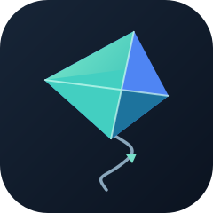
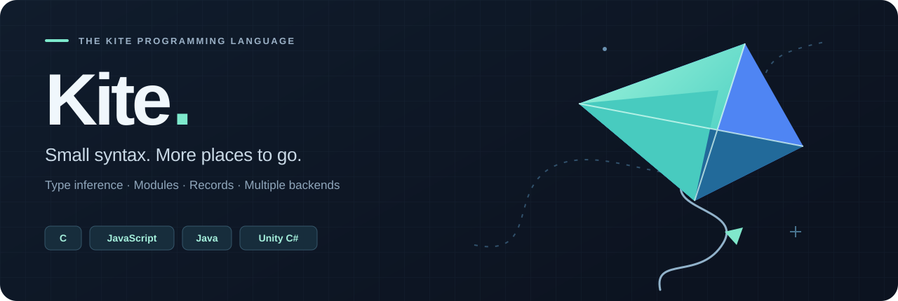
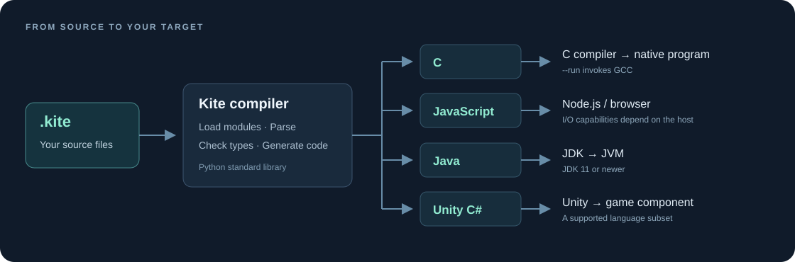

<p align="center">
  <a href="docs/assets/logo.svg"></a>
</p>

<h1 align="center">Kite</h1>

<p align="center"><strong>一门带类型推断的静态类型语言，可转译为 C、JavaScript、Java 和 Unity C#。</strong></p>

<p align="center">
  <a href="#快速开始">快速开始</a> ·
  <a href="#语言示例">语言示例</a> ·
  <a href="#选择后端">选择后端</a> ·
  <a href="#文档与示例">文档与示例</a> ·
  <a href="LICENSE">MIT 许可证</a>
</p>

<p align="center">
  
</p>

Kite 用缩进组织代码块，用 `p` 打印、`rp` 循环、`rp ut` 重复直到条件成立、`ret` 返回值。变量类型在编译阶段确定，函数类型通常可以推断。程序可以从一个 `.kite` 文件开始，再用相对路径模块、不可变记录和记录数组组织代码。

> Kite 仍在开发中。各后端共享核心语言规则，平台功能和内置函数的支持范围各有不同。

## 快速开始

安装 Python 3.8+ 和支持 BigInt 的现代 Node.js。转译器只使用 Python 标准库。

```sh
git clone https://github.com/keneskim/kite.git
cd kite
python kite.py examples/hello.kite --js
node examples/hello.js
```

输出的第一行是 `你好，世界！`。Linux 和 macOS 上可将 `python` 换成 `python3`。已有 GCC 时，可运行 `python kite.py examples/hello.kite --run`，直接编译并运行原生程序。

## 语言示例

下面的程序把商品与价格放在同一个记录数组中，再逐项累计。记录字段有类型，`price` 的参数和返回值则由转译器推断。

```kite
record Item(name: string, amount: number)

fn price(item)
    ret item.amount

items = [Item("风筝", 18), Item("线轴", 12)]
items.push(Item("彩带", 5))

total = 0
rp item in items
    total = total + price(item)

p "共 {len(items)} 件，合计 {total} 元"
```

```text
共 3 件，合计 35 元
```

- **数组从 1 开始。** `items[1]` 取第一项，`items[-1]` 取最后一项，`items[1..-1]` 创建独立的数组副本。
- **记录字段不可变。** 可用新记录替换数组元素。记录数组支持 `push`、切片、遍历和函数参数。
- **模块按文件组织。** `use "geo.kite"` 从当前文件所在目录加载模块，其中的 `Point`、`shift` 等名字可以直接使用。

```kite
use "geo.kite"

p shift(Point(2, 3), 5).x
```

更多语法和完整程序见 [语言教程](docs/kite.md)与[模块、记录和外部 C 函数指南](docs/modules.md)。

## 选择后端



以下命令均从仓库根目录执行。

| 目标 | 转译命令 | 运行方式 |
| --- | --- | --- |
| C | `python kite.py examples/hello.kite --run` | GCC 编译并运行。省略 `--run` 时只生成 C 源码。 |
| JavaScript | `python kite.py examples/hello.kite --js` | `node examples/hello.js`，也可将适用的脚本加载到现代浏览器。 |
| Java | `python kite.py examples/hello.kite --java` | 用 JDK 11+ 执行 `javac -encoding UTF-8 examples/Hello.java`，再执行 `java -cp examples Hello`。 |
| Unity C# | `python kite.py unity/game.kite --unity` | 将生成的 `Game.cs` 加入 Unity 项目，按指南安装到场景中的对象上。 |

C、JavaScript 和 Java 支持数字数组、文本数组和二维表。Unity 后端支持一维记录数组，以及面向 Unity 的输入和物理辅助函数。JavaScript 的标准输入和文件操作依赖 Node.js。`serve` 本地网页和 `extern` 属于 C 后端，后者目前只接受 `number` 参数和返回值，对应 C 的 `double`。

各目标的详细要求见 [JavaScript](docs/js.md)、[Java](docs/java.md)、[Unity](docs/unity.md)和 [C 外部函数](docs/modules.md#调用-c-外部函数)。

## 文档与示例

| 目标 | 从这里开始 |
| --- | --- |
| 学习语法 | [入门教程与语言速查](docs/kite.md) |
| 写多文件程序 | [模块入口](examples/modules/main.kite)、[记录数组](examples/modules/record_arrays.kite) |
| 练习算法 | [八皇后](contest/1-queens.kite)、[大数阶乘](contest/2-factorial.kite) |
| 做交互程序 | [猜数字](examples/guess.kite)、[本地待办清单](apps/README.md) |
| 写 Unity 组件 | [角色控制示例](unity/README.md) |

## 开发与贡献

```sh
python tests/run.py
python -m unittest discover -s tests -p test_modules.py
```

回归测试会转译示例、运行目标程序并比对输出和诊断。缺少外部工具的后端会在默认模式下标为跳过。Unity 测试使用 API 桩。工具要求和单后端运行方式见 [测试说明](tests/README.md)。

欢迎在 [Issues](https://github.com/keneskim/kite/issues) 提交问题，或通过 Pull Request 贡献代码。反馈编译问题时，请附上最小可复现的 Kite 程序、命令、目标后端、工具版本以及预期和实际输出。

## 当前限制

- 数组不能从函数返回或作为记录字段。函数可以替换传入数组的元素，但不能对它追加元素。
- 数字使用双精度浮点。超过 `2^53` 的整数可能失去精度。
- C 后端尚无自动内存回收。频繁构造数组或拼接文本的长时间运行程序需要留意内存增长。
- `serve` 只监听 `127.0.0.1`，用于本地演示。

更完整的约定见 [语言指南](docs/kite.md)和[模块与记录指南](docs/modules.md)。

## 许可证

Copyright © 2026 keneskim。项目采用 [MIT License](LICENSE)。
